# Zabbix 7.0 – Ubuntu Server Monitoring

## Project Overview

This project deploys a monitoring solution based on **Zabbix 7.0 LTS** on **Ubuntu Server 26.04 LTS**, running in a **VMware Workstation** lab. It monitors a **GLPI** server in real time (CPU, memory, disk, network) and raises an alert when its HTTPS service becomes unavailable. The alert was validated with a controlled outage test.

## Technologies Used

- Ubuntu Server 26.04 LTS
- Zabbix 7.0 (server, frontend, agent)
- VMware Workstation
- MariaDB 11.8
- Apache 2
- GLPI
- SSH (PowerShell)
- HTTPS / TLS

## Project Objectives

- Deploy and configure a Zabbix server on a dedicated VM.
- Register a GLPI server as a monitored host using the Zabbix agent.
- Monitor CPU, memory, disk and network performance.
- Create an item and a trigger to monitor HTTPS availability.
- Test the alert with a service outage and verify recovery.
- Identify and troubleshoot infrastructure issues.

## Infrastructure Architecture

Two Ubuntu Server virtual machines under VMware Workstation, one per service, to avoid Apache and MariaDB conflicts between GLPI and Zabbix.

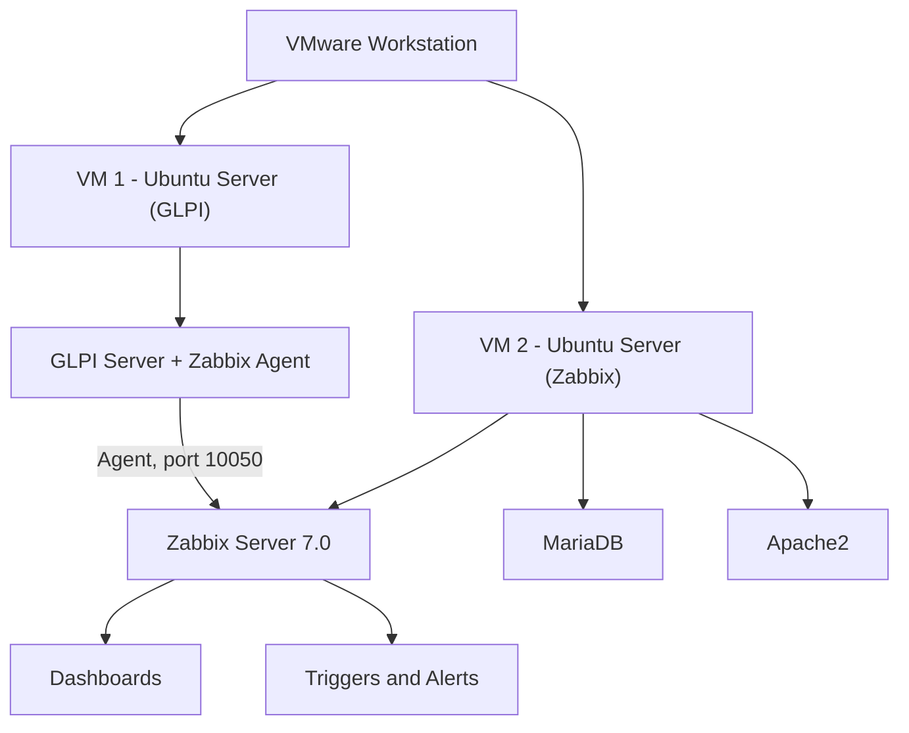

| Component | Detail |
|---|---|
| Hypervisor | VMware Workstation |
| OS | Ubuntu Server 26.04.1 LTS |
| Zabbix VM | 2 CPU, 25 GB disk, NAT network |
| Monitored VM | GLPI server with Zabbix agent |
| Remote access | SSH from Windows PowerShell |

## Implementation

### 1. Virtual machine

Disk, memory, CPU, NAT network and Ubuntu Server ISO.


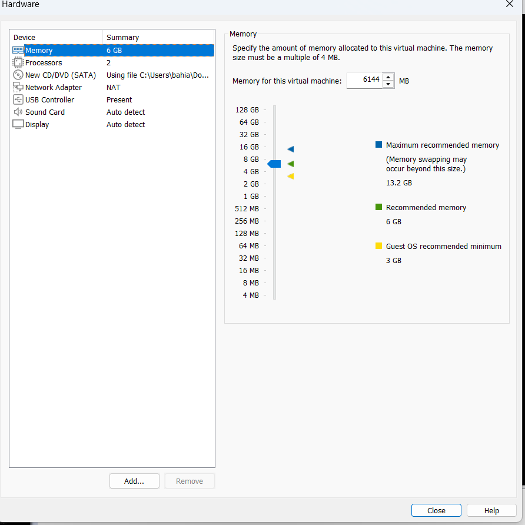

### 2. Hostname, IP address and SSH access

SSH from PowerShell allows copy and paste of commands.

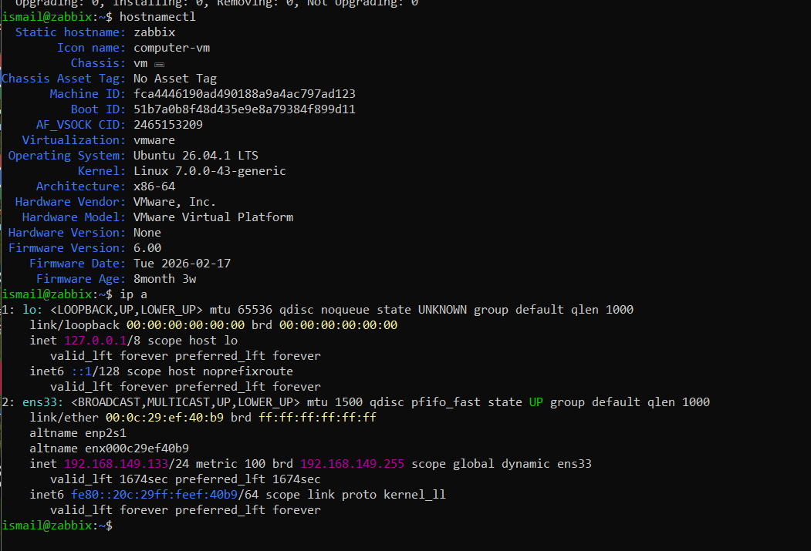

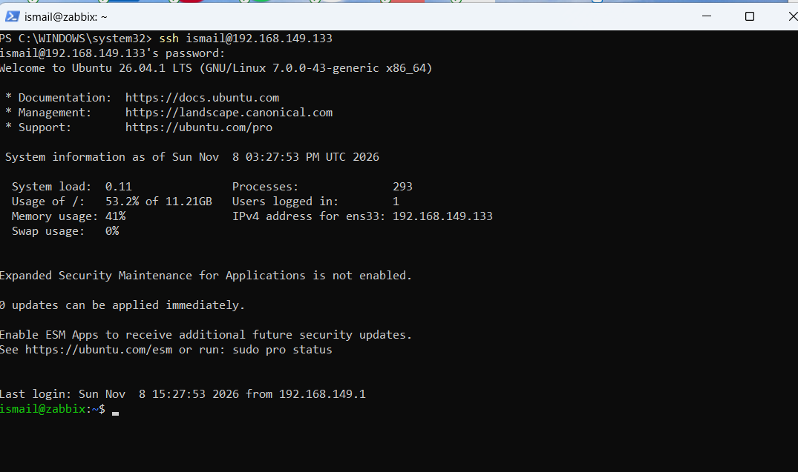

### 3. MariaDB

```bash
sudo apt update && sudo apt upgrade -y
sudo apt install -y mariadb-server
systemctl status mariadb --no-pager
```

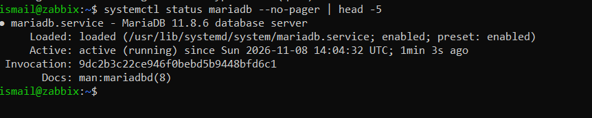

### 4. Official Zabbix repository

```bash
. /etc/os-release
wget "https://repo.zabbix.com/zabbix/7.0/ubuntu/pool/main/z/zabbix-release/zabbix-release_latest_7.0+ubuntu${VERSION_ID}_all.deb"
sudo dpkg -i "zabbix-release_latest_7.0+ubuntu${VERSION_ID}_all.deb"
sudo apt update
apt policy zabbix-server-mysql
```

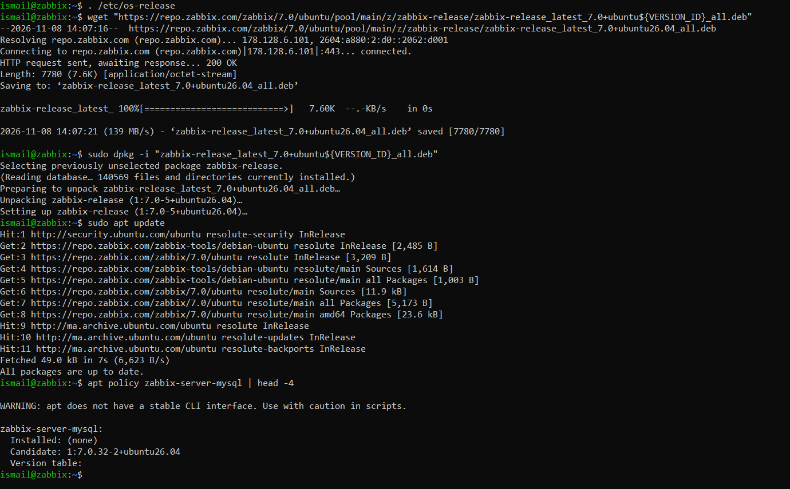

### 5. Zabbix installation and database

```bash
sudo apt install -y zabbix-server-mysql zabbix-frontend-php zabbix-apache-conf zabbix-sql-scripts zabbix-agent2
```

```sql
CREATE DATABASE zabbix CHARACTER SET utf8mb4 COLLATE utf8mb4_bin;
CREATE USER 'zabbix'@'localhost' IDENTIFIED BY '<PASSWORD>';
GRANT ALL PRIVILEGES ON zabbix.* TO 'zabbix'@'localhost';
SET GLOBAL log_bin_trust_function_creators = 1;
```

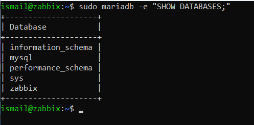

Schema import (204 lines returned by `SHOW TABLES`, i.e. 203 tables):

```bash
sudo zcat /usr/share/zabbix-sql-scripts/mysql/server.sql.gz | sudo mariadb --default-character-set=utf8mb4 zabbix
```


### 6. Services

On Ubuntu 26.04, the Apache module `proxy_fcgi` is required for the web interface.

```bash
sudo a2enmod proxy_fcgi setenvif
sudo systemctl restart zabbix-server zabbix-agent2 apache2
sudo systemctl enable zabbix-server zabbix-agent2 apache2
systemctl is-active zabbix-server zabbix-agent2 apache2 mariadb
zabbix_server --version
```

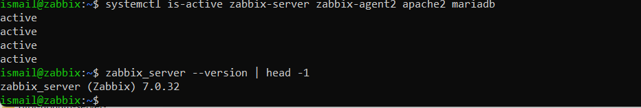

### 7. Web interface

Installation wizard on `http://SERVER_IP/zabbix`, then login with the administrator account (default password changed after first login).

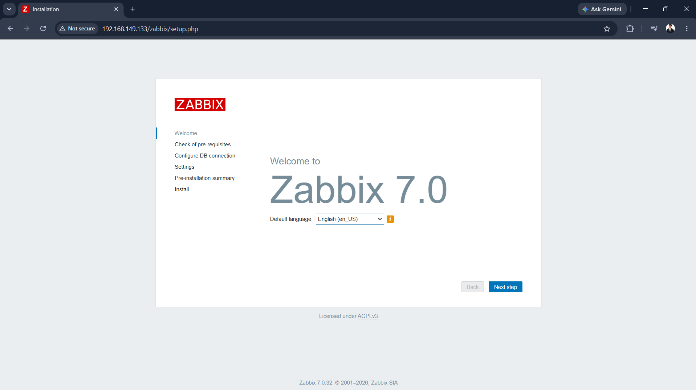

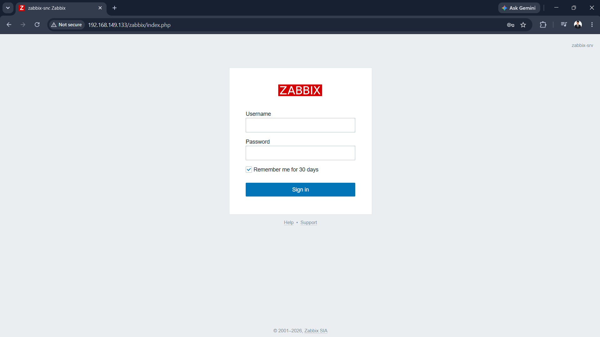

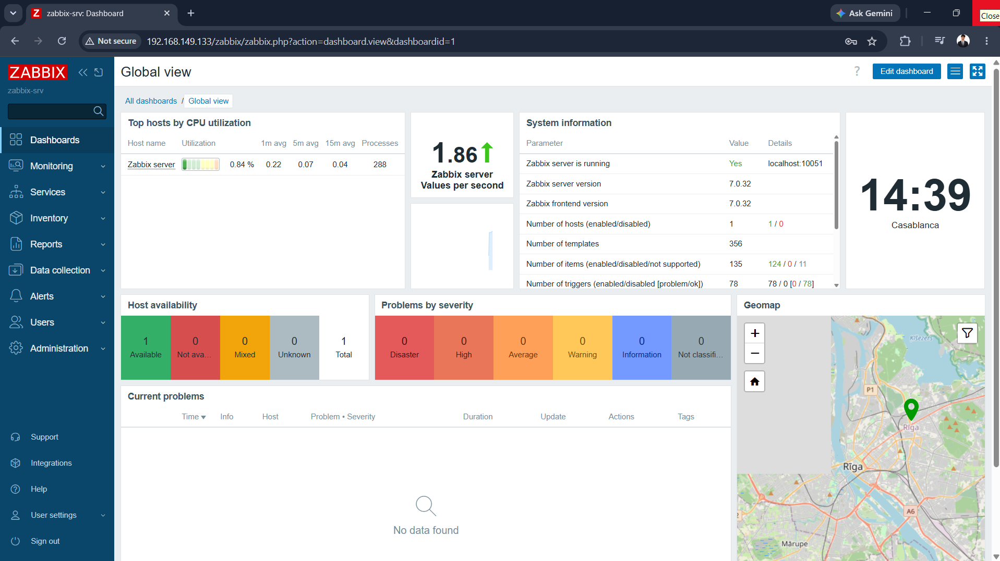

## Monitoring the GLPI Server

### 8. Zabbix agent

On the GLPI VM, the agent is configured with the Zabbix server address (`Server`, `ServerActive`) and `Hostname=glpi`.

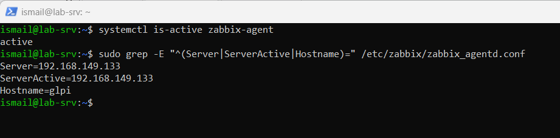

### 9. Host registration

Host `glpi` created with the template **Linux by Zabbix agent**, the group **Linux servers** and an agent interface on port 10050. The **ZBX** icon turns green when the agent answers.

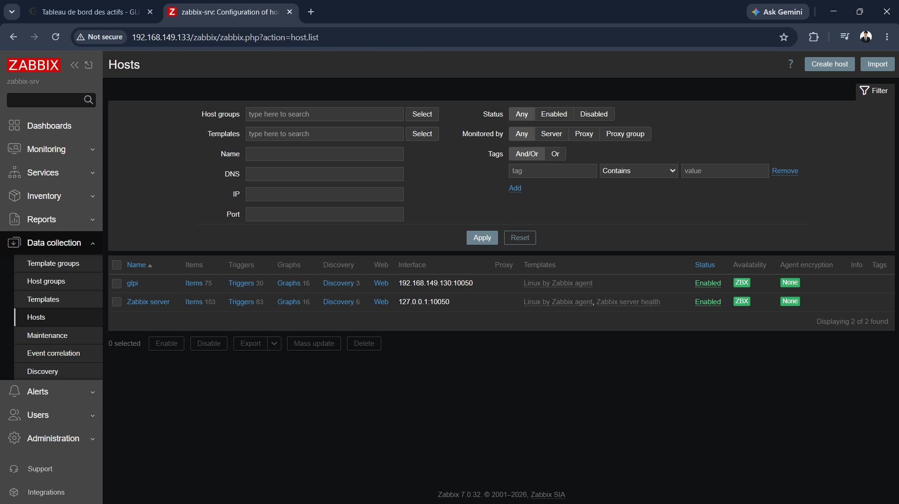

### 10. Host dashboards

Filesystems, network interfaces and system performance (load, CPU, memory, swap) are collected automatically.

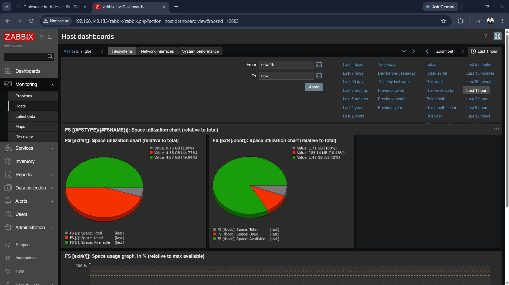

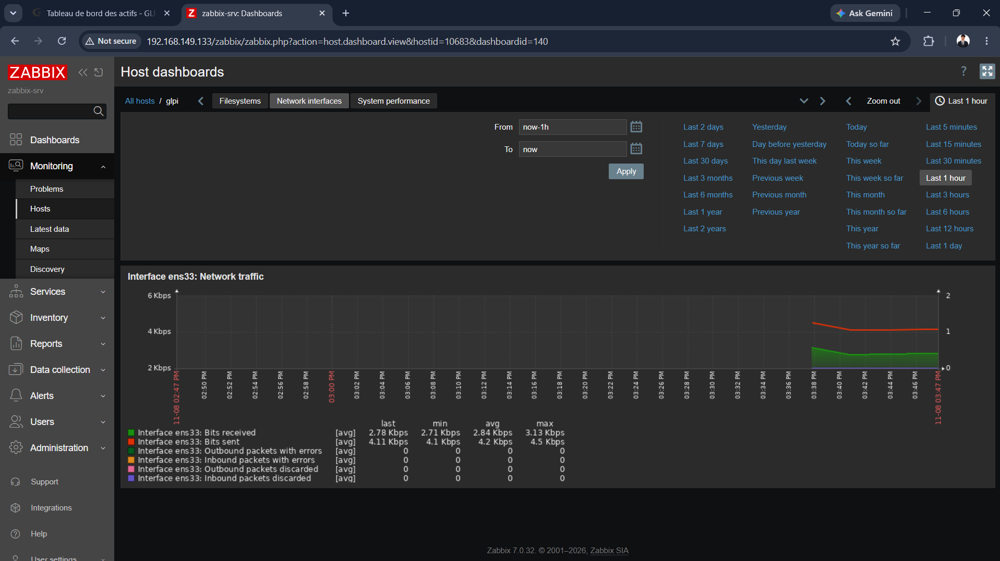

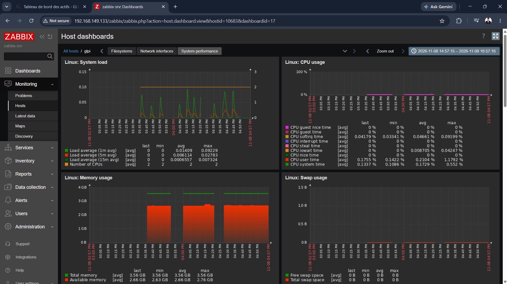

## HTTPS Availability Alert

### 11. Item and trigger

| Element | Value |
|---|---|
| Item | `net.tcp.service[tcp,,443]` |
| Update interval | 30 s |
| Trigger | `last(/glpi/net.tcp.service[tcp,,443])=0` |
| Severity | High |

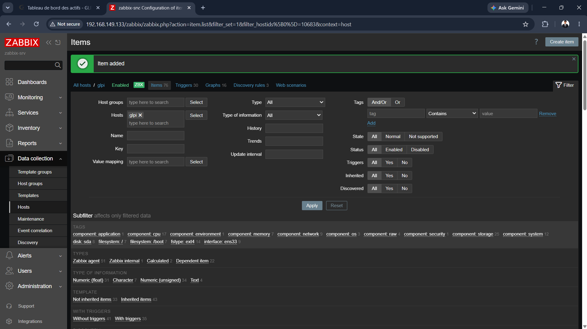

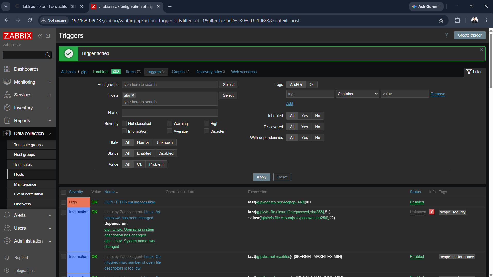

### 12. Outage test

Apache was stopped on the GLPI VM, then restarted.

```bash
sudo systemctl stop apache2
sudo systemctl start apache2
```

**Result:** the alert *GLPI HTTPS est inaccessible* appeared about one minute after the stop, and switched to *Resolved* after the restart.

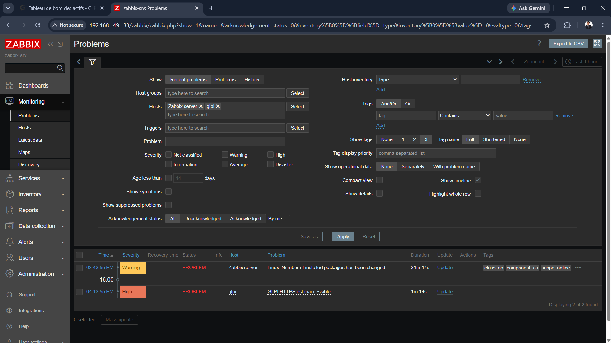

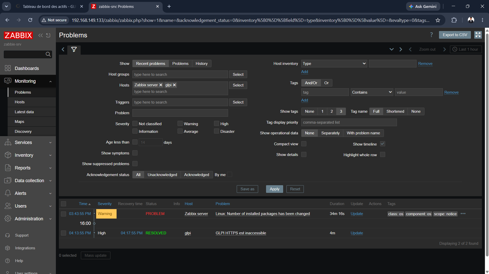

## Troubleshooting

| Problem | Cause | Solution |
|---|---|---|
| Old Zabbix server installed on the GLPI VM | First attempt on the same VM | Server packages and `zabbix` database removed, one dedicated VM per service |
| SSH: `Permission denied` | Ubuntu installation not finished, user not created | Finish the installation, then log in with the right user |
| SSH: `Connection timed out` after restoring a snapshot | Snapshot with memory, unstable network card (`irq 19: nobody cared`) | VM reboot, snapshots now taken with the VM powered off |
| `Permission denied` on `grep` of a config file | File readable by root and zabbix only | Added `sudo` |
| `Cannot add host`: `Field "groups" is mandatory` | Host group not selected | Selected it with the **Select** button |
| `Cannot add trigger`: invalid expression | Placeholder text typed instead of the expression | Entered the correct expression |
| Warning `Number of installed packages has been changed` | Linux template detecting package updates | Normal behaviour, problem closed manually |

## Skills Demonstrated

- Linux system administration (Ubuntu Server)
- Server and network monitoring (Zabbix)
- Database administration (MariaDB)
- Web server configuration (Apache)
- Virtualization (VMware)
- Alerting and failure testing
- Troubleshooting and technical documentation

## Next Steps

- E-mail notifications for alerts.
- Monitoring of additional services (SSH, MariaDB).
- Disk and memory thresholds.

## Author

**Ismail Bahia**
IT Infrastructure | Systems & Networks
GitHub: https://github.com/bahiaismail9-ai
