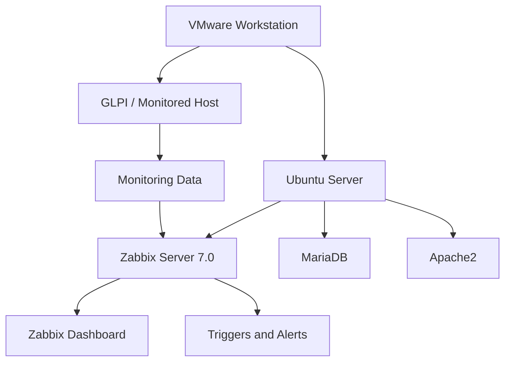

# Zabbix 7.0 – Ubuntu Server Monitoring 

## Project Overview

This project demonstrates the deployment and configuration of a monitoring solution using Zabbix 7.0 on Ubuntu Server.

The objective is to monitor a GLPI server hosted in a VMware virtualized environment, track system performance, monitor network activity, and detect potential infrastructure issues.

## Technologies Used

- Ubuntu Server
- Zabbix 7.0
- VMware Workstation
- MariaDB
- Apache2
- GLPI
- Linux Networking
- HTTPS / SSL-TLS

## Project Objectives

- Deploy and configure Zabbix Server.
- Integrate a GLPI server into Zabbix monitoring.
- Monitor CPU, memory, disk and network performance.
- Configure monitoring triggers and alerts.
- Monitor HTTPS service availability.
- Identify and troubleshoot infrastructure issues.

## Infrastructure Architecture

The environment consists of virtual machines running under VMware Workstation.

## Key Implementations

- Zabbix Server installation and configuration.
- Database configuration using MariaDB.
- Web interface deployment using Apache.
- Host registration and monitoring.
- Performance monitoring and trigger testing.
- HTTPS availability monitoring.

## Screenshots

Screenshots documenting the installation, configuration, monitoring dashboards and testing procedures are available in this repository.

## Skills Demonstrated

- Linux System Administration
- Server Monitoring
- Network Monitoring
- Virtualization
- Database Administration
- Troubleshooting
- Infrastructure Management

## Author

Ismail Bahia

IT Infrastructure | Systems & Networks

GitHub: https://github.com/bahiaismail9-ai

## Infrastructure Architecture

The following diagram illustrates the project architecture and the monitoring environment.

